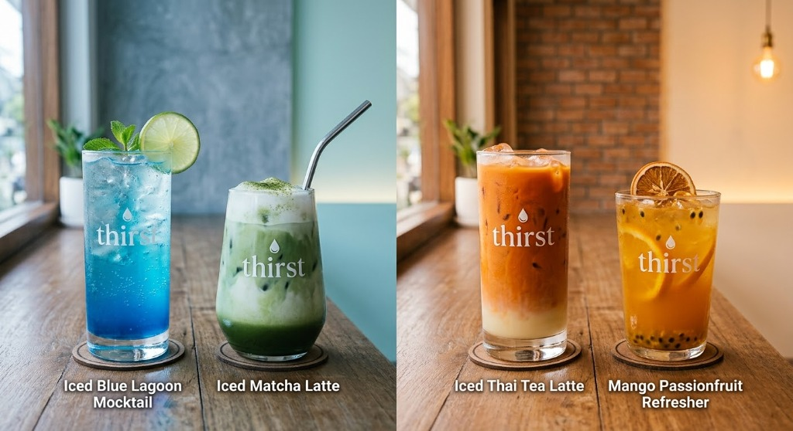

# thirst. | Artisan Beverage & JavaScript Liquid Craft 💧

เว็บไซต์เครื่องดื่มและแอนิเมชันของเหลวแบบอินเทอร์แอคทีฟ (Interactive JavaScript Animation Website) สร้างด้วย **HTML5 Canvas 2D Physics, Vanilla JavaScript, และ Tailwind CSS**

---

## 🌟 ฟีเจอร์เด่น (Key Features)

- **Canvas 2D Wave Simulation:** คลื่นของเหลวจำลองด้วยสมการฟิสิกส์คลื่น Sine Wave แบบไดนามิก
- **3D Perspective Tilt:** แก้วเครื่องดื่มเอียงตามเมาส์แบบ 3 มิติ พร้อมแรงเหวี่ยงของเหลว (Slosh Inertia)
- **4 Signature Drinks:** เปลี่ยนเมนูเครื่องดื่ม 4 สไตล์ (Blue Lagoon, Matcha Latte, Thai Tea, Mango Passionfruit)
- **Mixology Studio:** ห้องทดลองผสมเครื่องดื่ม DIY ปรับเบส, รสชาติ, ความหวาน, และปริมาณน้ำแข็งได้แบบเรียลไทม์
- **Synthesized Sound FX:** ระบบเสียงประกอบ (ฟองซ่า, น้ำแข็งกระทบ, คนน้ำ) ด้วย Web Audio API โดยไม่ต้องใช้ไฟล์เสียงภายนอก
- **Fly-to-Cart Animation:** แอนิเมชันอนุภาคพุ่งเข้าสู่ตะกร้า พร้อม Slide-over Drawer
- **Responsive & Lightweight:** รองรับทั้งจอมือถือ แท็บเล็ต และคอมพิวเตอร์ จบในไฟล์เดียว

---

## 🚀 วิธีเปิดใช้งาน (Getting Started)

1. ดาวน์โหลดหรือ Clone repository นี้
2. ดับเบิลคลิกเปิดไฟล์ `index.html` บนเบราว์เซอร์ (Google Chrome, Microsoft Edge, Safari) ได้ทันที

---

## 🌐 การเปิดออนไลน์ผ่าน GitHub Pages (ฟรี)

1. อัปโหลดไฟล์ทั้งหมดขึ้น GitHub Repository
2. ไปที่ **Settings** > **Pages**
3. ที่หัวข้อ **Build and deployment**:
   - Source: เลือก `Deploy from a branch`
   - Branch: เลือก `main` หรือ `master` และโฟลเดอร์ `/ (root)`
4. กด **Save** รอ 1-2 นาที คุณจะได้ URL เว็บไซต์ที่เปิดดูออนไลน์ได้ทันที
